# machine-wilds

A Claude Code skill and the engine behind it. Give it a place and it builds a 3D world you can walk through in the
browser: a ruined, overgrown landscape where giant walking machines keep their rounds in the mist. The machines are
put together from code, part by part, and their feet land on the real height and slope of the ground.

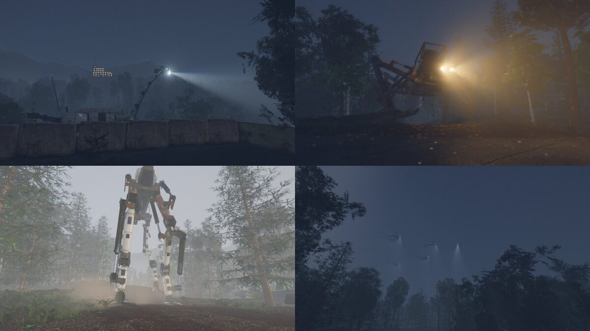

[](https://jungrok5.github.io/machine-wilds/)
[](https://jungrok5.github.io/machine-wilds/?film=1)

- Walk the worked example in the browser: https://jungrok5.github.io/machine-wilds/
- The same valley playing its own film (2 min 47 s, dawn to night): https://jungrok5.github.io/machine-wilds/?film=1

A personal project by [Jeongrok Oh](https://jungrok5.github.io/resume/), an MMO server architect. Two habits from
server work run through it: every machine's state is recomputed from the clock, and nothing is rendered until
automated checks on the bodies pass.

## How it works

### Machines

Each leg is a planar chain of segments solved in closed form. Every powered joint has a
two-part hydraulic cylinder, and a search places its two anchors so the rod stays at least 15 % inside the barrel over
the joint's whole range of motion. Fittings (pipes, hoses, rivets, hatches, ladders, rails) are laid on afterwards, and
each kind has an age that puts rust streaks, grime and moss where water would run.

### Pose as a function of time

Given the world clock `t`, the gait computes where every foot is, from
the machine's closed way and the phase of each leg, with no state carried between frames. The page, a still, a frame
of the film and the Node checks all get the same pose for the same `t`, so film frames can be drawn in any order and a
stopped render picks up where it left off. The walker's own two-legged machine is the exception: it follows the keys,
so it steps from state.

### Footfalls on real ground

Each foot reads the height and slope where it will land; a planted foot is
fixed in the world (measured slip 0.00 mm against a 4 mm limit); the body's height and lean come from the feet that
carry it, and steps shorten on a grade.

### Checks before rendering

`scripts/gym.mjs` runs the same gait code in Node, without a
browser, and judges every machine over a whole lap against 27 limits: slip, reach, joints folding past their stops,
the cylinders' stroke, clearance under the belly, determinism (the same `t` twice must agree to 1e-9), a breathing
idle, and anticipation and recovery around each big move. Every kind must also cross a test course with a 14° ramp, a
1.2 m drop, a 12° side slope, a ditch and a mound. A kind that fails is fixed in its own numbers or in the line of its
way, never by loosening a limit.

### Renderer

A deferred WebGL 2 renderer on three.js r170, forked from the `scanned-realm` skill. Surfaces, models
and leaf atlases are Poly Haven CC0 scans, fetched when a realm is built (not committed) and reduced to levels of
detail with meshoptimizer at load. Machine lamps are marched through the fog as beams with halos. The weather
runs through clear, rain, snow, mist and haze, and the hour through a full day.

### A film the page plays

`lib/89_cine.js` plays a list of shots with free cameras while the walker's machine
is driven by keys. `?film=1` plays it live; `examples/iron-valley/trailer.mjs` steps the same shots to draw frames
(3,857 for the example) and joins them with sound synthesized from the machines' footfalls. On a machine with no GPU,
timing one quality setting at a time showed the shadow maps were half of each frame: at half their resolution a frame
went from 8.7 s to 4.1 s with no difference visible at 960 × 540.

## How a realm is made

1. **Input**: one line about a place, what it was, why it was left, and the hour.
2. **Brief**: the rise and fall of the land and where the ruins stand; for each kind of machine its job, size, weight, legs, gait numbers, set piece and lamps; the ways the machines walk.
3. **Numbers first**: `gym.mjs` walks every machine over the test course and along its way on the real land, without a browser, and reports in numbers.
4. **Parts and world**: joints and cylinders, fittings, a body, head and lamps written new for each kind; ruins and forest from scanned surfaces and models; footprints pressed into the ground.
5. **Look**: a cast sheet per kind (four sides, walk, idle, set piece), close sheets, the page check (`check.mjs`), stills.
6. **Output**: one walkable page (scans read from `assets/` or from Poly Haven's server), with the sheets, map and stills.

## The example: 쇠울림 골짜기

A pass where a maintenance yard was left forty years ago. The land is 640 m across, from −3 m at the brook to 47 m
on the north ridge, with a broken viaduct, a hall, pylons, a container yard. Nineteen machines of eight kinds: two long-necked watchers, three
six-legged carriers, a relay station 73 m tall that weighs 5,200 t and walks the rim, five flying kites, two turtles,
a crayfish, four woodlice, and the walker's own body. Sources are in `examples/iron-valley/src/`, the design in its
`BRIEF.md`.

Each picture opens the live page at that spot and hour.

<table>
<tr><td width="50%" valign="top"><a href="https://jungrok5.github.io/machine-wilds/?at=-22,58,0&amp;eye=third&amp;tod=20.4&amp;wx=mist&amp;tour=0">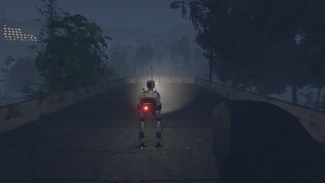</a><br><b>Plover, from behind</b> · <sub>third person · mist</sub><br>The walker&#x27;s own body: two legs, 1.9 m, 0.3 t. Its lamp (B) lights the fog.</td><td width="50%" valign="top"><a href="https://jungrok5.github.io/machine-wilds/?at=-22,46,0&amp;eye=top&amp;tod=20.4&amp;wx=mist&amp;tour=0">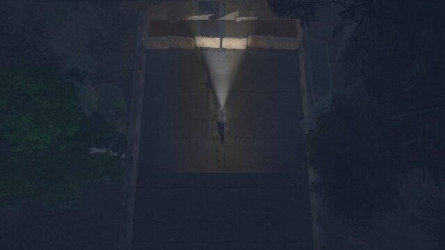</a><br><b>The viaduct from above</b> · <sub>top view · mist</sub><br>Top view. The wheel or + and − change the height.</td></tr>
<tr><td width="50%" valign="top"><a href="https://jungrok5.github.io/machine-wilds/?at=-147,118,90&amp;eye=third&amp;tod=13&amp;wx=clear&amp;tour=0">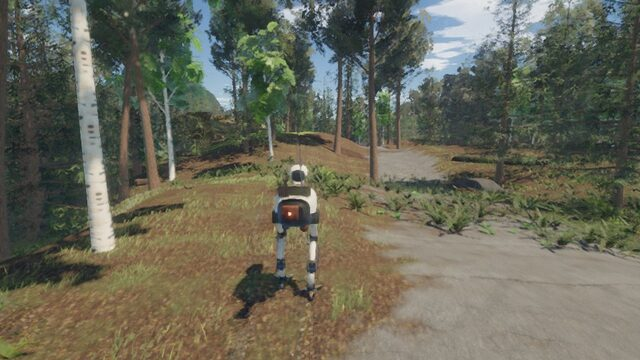</a><br><b>Plover on the forest road</b> · <sub>third person · clear</sub><br>Feet land on the real ground height; a planted foot does not slide.</td><td width="50%" valign="top"><a href="https://jungrok5.github.io/machine-wilds/?at=-23.2,44.4,21&amp;t=160&amp;tod=20.4&amp;wx=mist&amp;tour=0">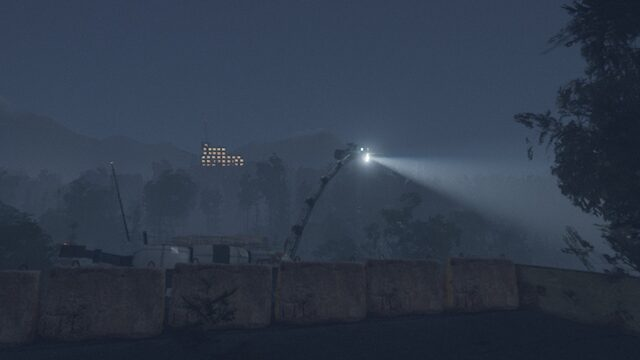</a><br><b>At the end of the viaduct</b> · <sub>mist · 20:24</sub><br>The crane stops 26 m ahead, raises its head and looks round (the set piece called survey: anticipation, peak, recovery).</td></tr>
<tr><td width="50%" valign="top"><a href="https://jungrok5.github.io/machine-wilds/?at=45.8,14.8,-88&amp;t=192&amp;tod=20.4&amp;wx=mist&amp;tour=0">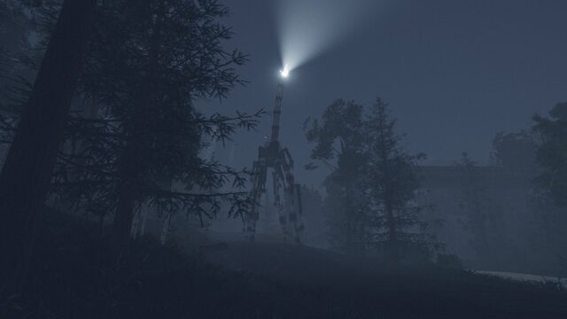</a><br><b>The crane&#x27;s searchlight</b> · <sub>crane · 25 m · 86 t</sub><br>One searchlight (an 8° cone) at the end of a long neck, seen as a beam in the fog.</td><td width="50%" valign="top"><a href="https://jungrok5.github.io/machine-wilds/?at=-18.6,-87.4,-90&amp;t=20.5&amp;tod=20.4&amp;wx=mist&amp;tour=0">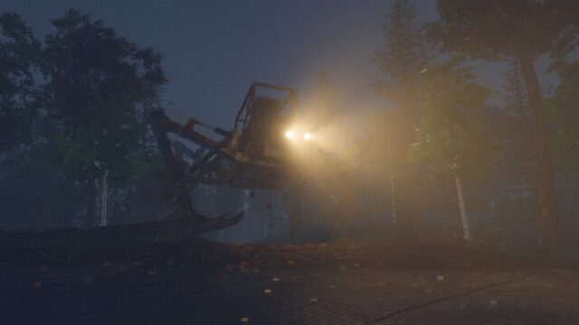</a><br><b>The porter&#x27;s two eyes</b> · <sub>porter · 6 legs · 38 t</sub><br>A rusty steel cargo frame and a tripod gait. Each foot is set to the height and slope where it lands.</td></tr>
<tr><td width="50%" valign="top"><a href="https://jungrok5.github.io/machine-wilds/?at=-22.4,47.8,-164&amp;t=46&amp;tod=20.4&amp;wx=mist&amp;tour=0">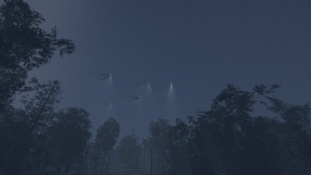</a><br><b>Five kites</b> · <sub>kite · 9.4 m span · flies</sub><br>The wings are powered bones. A kite slows as it climbs, banks before it turns, beats a few times and glides.</td><td width="50%" valign="top"><a href="https://jungrok5.github.io/machine-wilds/?at=-151,120.6,-131&amp;t=974&amp;tod=20.4&amp;wx=mist&amp;tour=0">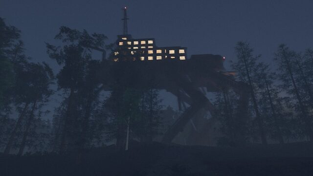</a><br><b>The relay station passes</b> · <sub>ridge · 73 m · 5,200 t</sub><br>One stride takes 15 s. The ground shakes at every footfall and the footprints stay pressed in.</td></tr>
<tr><td width="50%" valign="top"><a href="https://jungrok5.github.io/machine-wilds/?at=-265.8,68.2,147&amp;t=976&amp;tod=20.4&amp;wx=mist&amp;tour=0">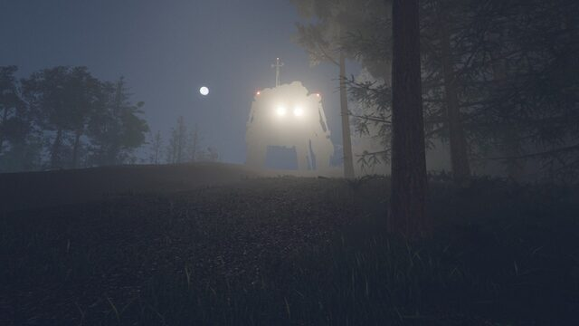</a><br><b>The relay station&#x27;s eyes</b> · <sub>two eyes, 33 m up</sub><br>Every kind has its own lamp colour and count, so they can be told apart by their lights alone.</td><td width="50%" valign="top"><a href="https://jungrok5.github.io/machine-wilds/?at=9,122.4,88&amp;tod=22.5&amp;wx=mist&amp;tour=0">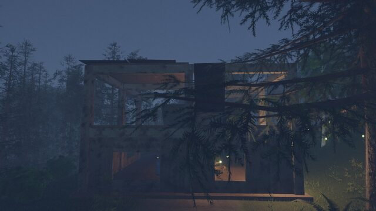</a><br><b>The fire in the hall</b> · <sub>mist · 22:30</sub><br>The one warm light in the cold fog.</td></tr>
<tr><td width="50%" valign="top"><a href="https://jungrok5.github.io/machine-wilds/?at=-64,34.8,-63&amp;t=88.6&amp;tod=6.5&amp;wx=mist&amp;tour=0">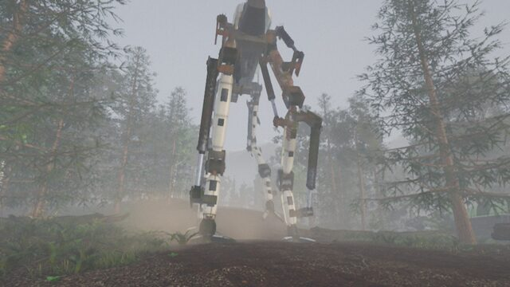</a><br><b>Dawn, under the legs</b> · <sub>mist · 06:30</sub><br>White ceramic casing with rust streaks and grime; a drum and a hydraulic cylinder at every joint.</td><td width="50%" valign="top"><a href="https://jungrok5.github.io/machine-wilds/?at=-23,43.9,-35&amp;t=128.8&amp;tod=13&amp;wx=clear&amp;tour=0">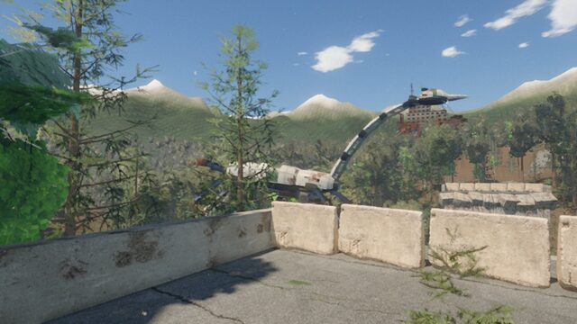</a><br><b>A back at eye level</b> · <sub>clear · 13:00</sub><br>The viaduct deck is 22 m up, the height of the crane&#x27;s back.</td></tr>
<tr><td width="50%" valign="top"><a href="https://jungrok5.github.io/machine-wilds/?at=-100,127,80&amp;tod=13&amp;wx=clear&amp;tour=0">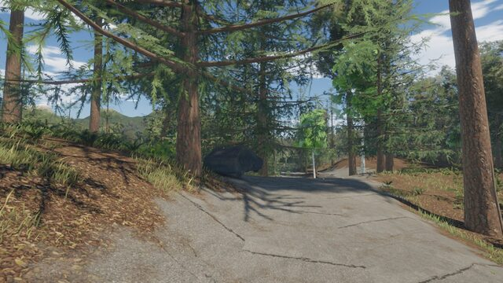</a><br><b>The old road</b> · <sub>scans · Poly Haven CC0</sub><br>Asphalt, concrete, forest floor, ferns and the covered car are all scans.</td><td width="50%" valign="top"><a href="https://jungrok5.github.io/machine-wilds/?at=115,-116.8,146&amp;t=162&amp;tod=15&amp;wx=clear&amp;tour=0">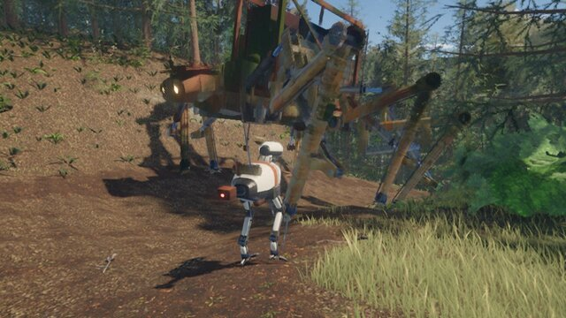</a><br><b>The porter kneels in the yard</b> · <sub>porter · 38 t · kneel</sub><br>The set piece kneel: it rises a little, the cargo bed drops 1.7 m, it waits, then stands back up past its own height.</td></tr>
<tr><td width="50%" valign="top"><a href="https://jungrok5.github.io/machine-wilds/?at=112,108,-30&amp;t=20&amp;tod=18.8&amp;wx=clear&amp;tour=0">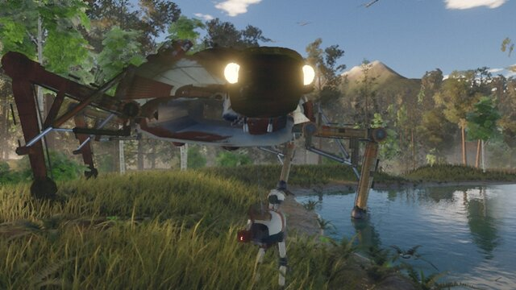</a><br><b>The turtle by the tarn</b> · <sub>turtle · 150 t · a dome of plate</sub><br>A shell as wide as a house. One stands by the tarn, one walks the east floor. Set piece: pull the neck in and settle.</td><td width="50%" valign="top"><a href="https://jungrok5.github.io/machine-wilds/?at=-72.8,-36.5,-55&amp;t=60&amp;tod=20.4&amp;wx=mist&amp;tour=0">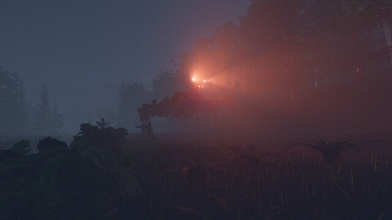</a><br><b>The crayfish in the brook</b> · <sub>crayfish · 64 t</sub><br>The valley&#x27;s monster: two claws, feelers, a jointed tail and tail fan, red eyes on stalks. Set piece: rear up.</td></tr>
<tr><td width="50%" valign="top"><a href="https://jungrok5.github.io/machine-wilds/?at=-84.9,52.3,-28&amp;t=60&amp;tod=15&amp;wx=clear&amp;tour=0">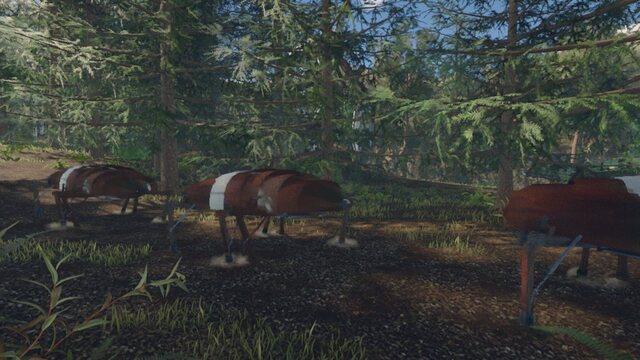</a><br><b>Woodlice in file</b> · <sub>woodlice · 1.6 t · four in file</sub><br>Four machines the size of a person walk 5 m apart, stop together and curl up together.</td><td width="50%" valign="top"><a href="https://jungrok5.github.io/machine-wilds/?film=1">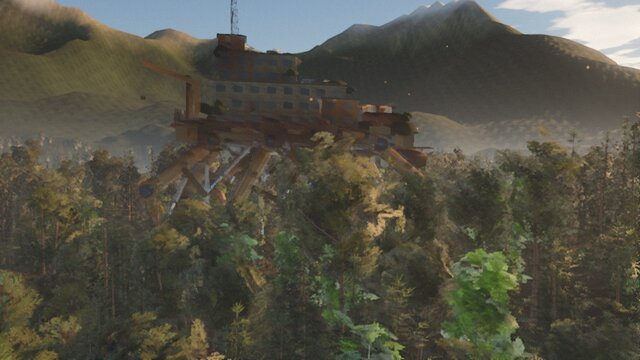</a><br><b>The relay station on the far rim</b> · <sub>film · dawn</sub><br>The film&#x27;s first shot: the hour runs from 5 to 9 in the morning while the relay station walks the rim.</td></tr>
<tr><td width="50%" valign="top"><a href="https://jungrok5.github.io/machine-wilds/?at=-22,30,0&amp;eye=third&amp;t=168&amp;tod=15.1&amp;wx=rain&amp;tour=0">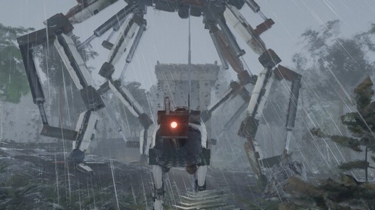</a><br><b>Where the walker landed, before the crane</b> · <sub>rain · the leap from the viaduct</sub><br>Over the barrier and 15 m down. Rain, wet ground, ripples.</td><td width="50%" valign="top"><a href="https://jungrok5.github.io/machine-wilds/?film=1">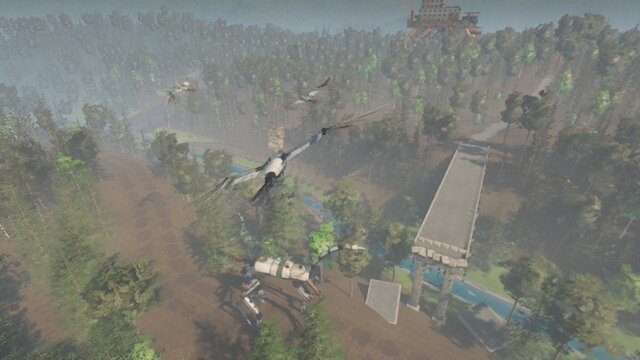</a><br><b>In the film, following a kite</b> · <sub>free camera · light mist 08:30</sub><br>A shot from the film the page plays (?film=1): 28 shots from dawn to night, live. Esc hands over to walking.</td></tr>
<tr><td width="50%" valign="top"><a href="https://jungrok5.github.io/machine-wilds/?at=20,-222.5,-62&amp;t=150&amp;tod=18.2&amp;wx=haze&amp;tour=0">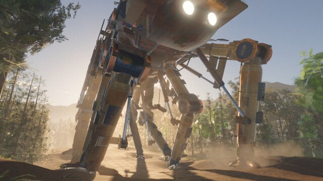</a><br><b>Under the relay station&#x27;s legs</b> · <sub>casing legs · deck 28 m overhead</sub><br>The walkable land reaches the rim road, so you can walk in among its legs as it goes. Plated casing, joint housings, foot pads.</td><td width="50%" valign="top"><a href="https://jungrok5.github.io/machine-wilds/?at=60,-226,-82&amp;t=150&amp;tod=18.2&amp;wx=haze&amp;tour=0">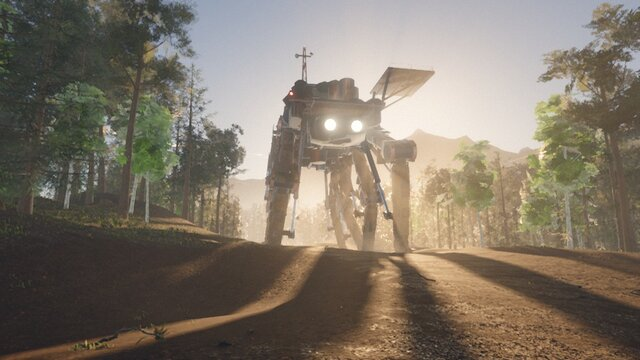</a><br><b>The relay station against the sun</b> · <sub>haze · 18:12</sub><br>The haze weather: far things fade to pale silhouettes, near things keep their colour.</td></tr>
</table>

## Checks you can see

Every kind is turned in a studio before it goes into the world, and every gait is drawn over a cut through the real
land. A kind that does not pass is fixed in its numbers or its way. Each sheet links to the source it checks.

<table>
<tr><td width="50%" valign="top"><a href="https://github.com/jungrok5/machine-wilds/blob/main/examples/iron-valley/src/26_parts.js">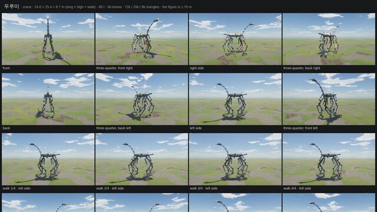</a><br><b>Crane</b> · <sub>66 bones · 72k / 20k / 8k triangles</sub><br>Front, back, both sides and three-quarter; walk on both sides; idle; the set piece at anticipation, peak and recovery.</td><td width="50%" valign="top"><a href="https://github.com/jungrok5/machine-wilds/blob/main/examples/iron-valley/src/26_parts.js">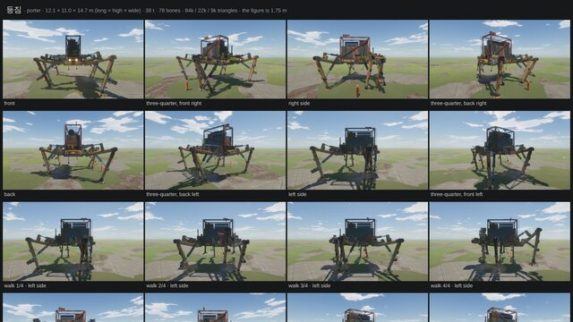</a><br><b>Porter</b> · <sub>78 bones · 84k / 22k / 9k triangles</sub><br>Insect legs (slew ring, arm, thigh, shin) with a hydraulic cylinder at every joint.</td></tr>
<tr><td width="50%" valign="top"><a href="https://github.com/jungrok5/machine-wilds/blob/main/examples/iron-valley/src/26_parts.js">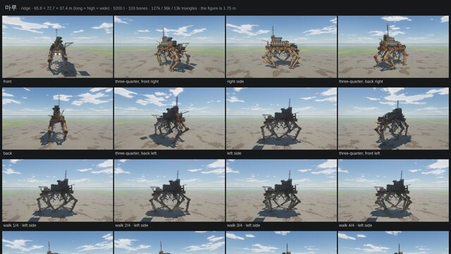</a><br><b>Relay station</b> · <sub>103 bones · 127k / 36k / 13k triangles</sub><br>66 × 73 × 33 m. The orange dot at its feet is a 1.75 m person.</td><td width="50%" valign="top"><a href="https://github.com/jungrok5/machine-wilds/blob/main/examples/iron-valley/src/26_parts.js">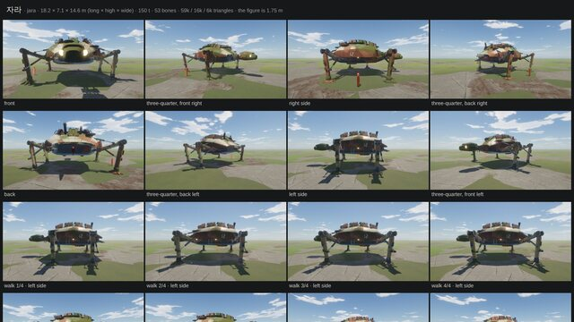</a><br><b>Turtle</b> · <sub>53 bones · 18.2 × 7.1 × 14.6 m</sub><br>The shell is a loft over the top half with three rows of plate on it. The settling move at anticipation, peak and recovery.</td></tr>
<tr><td width="50%" valign="top"><a href="https://github.com/jungrok5/machine-wilds/blob/main/examples/iron-valley/src/26_parts.js">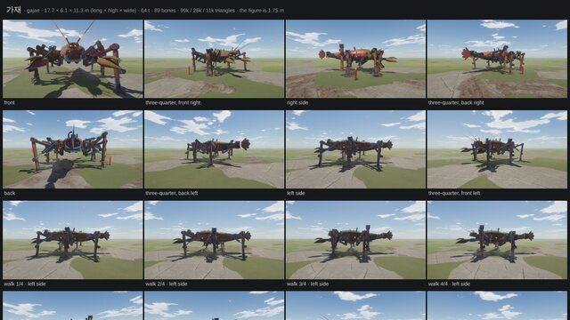</a><br><b>Crayfish</b> · <sub>89 bones · 99k / 25k / 11k triangles</sub><br>Claws, feelers and tail are bones that follow the body late. The rearing move.</td><td width="50%" valign="top"><a href="https://github.com/jungrok5/machine-wilds/blob/main/examples/iron-valley/src/26_parts.js">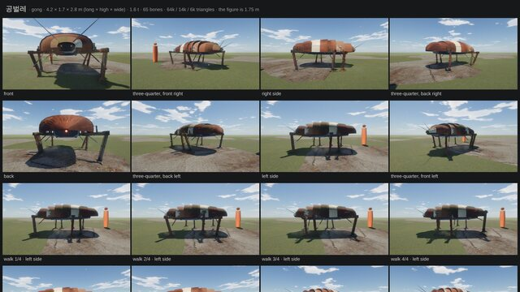</a><br><b>Woodlouse</b> · <sub>65 bones · 4.2 × 1.7 × 2.8 m</sub><br>A kind the size of a person. The test course shrinks its drop and ditch to its size.</td></tr>
<tr><td width="50%" valign="top"><a href="https://github.com/jungrok5/machine-wilds/blob/main/lib/48_mech_kit_fit.js">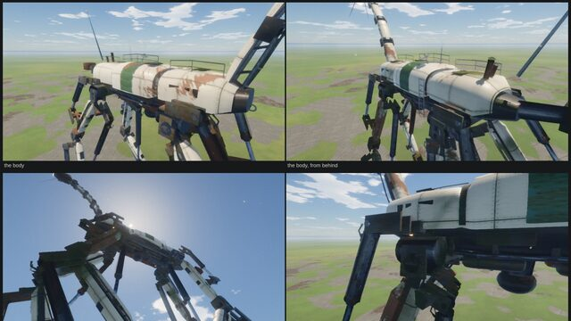</a><br><b>Crane at arm’s length</b> · <sub>--cast --close</sub><br>The hydraulic pack under the belly with a hose to each hip; rails, ladders, inspection hatches, rust streaks.</td><td width="50%" valign="top"><a href="https://github.com/jungrok5/machine-wilds/blob/main/lib/48_mech_kit_fit.js">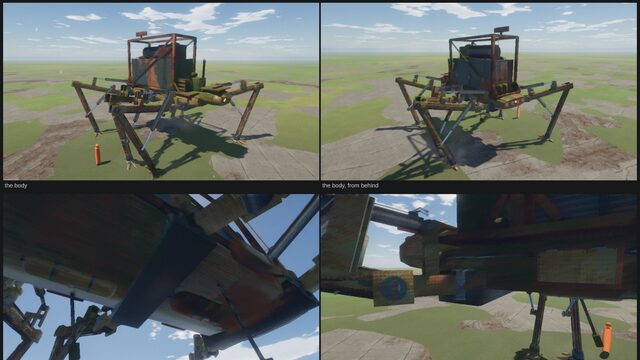</a><br><b>Porter at arm’s length</b> · <sub>tie rods · valve blocks · lacing · rivets</sub><br>Every cylinder has tie rods, a valve block, steel pipe and hoses; the legs carry conduit and junction boxes.</td></tr>
<tr><td width="50%" valign="top"><a href="https://github.com/jungrok5/machine-wilds/blob/main/lib/48_mech_kit_fit.js">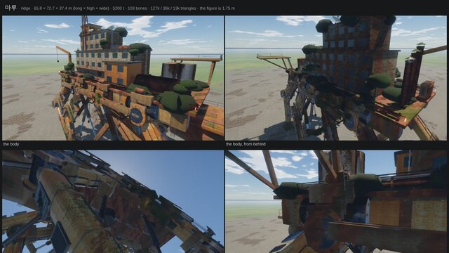</a><br><b>Relay station, deck and legs</b> · <sub>mains · accumulators · stacks · galleries</sub><br>Mains on both sides of the deck, an accumulator at each hip, ladders and walkways on the building.</td><td width="50%" valign="top"><a href="https://github.com/jungrok5/machine-wilds/blob/main/lib/48_mech_avatar.js">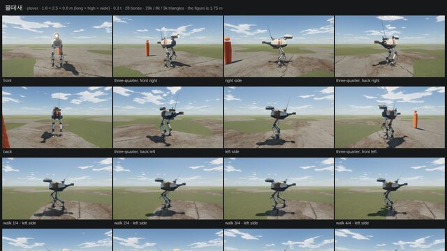</a><br><b>Plover (the walker&#x27;s body)</b> · <sub>walk · run · turn · back · hop</sub><br>Walk and run at each quarter, turning on the spot, stepping back, a hop at crouch, air and landing.</td></tr>
<tr><td width="50%" valign="top"><a href="https://github.com/jungrok5/machine-wilds/blob/main/lib/48_mech_fly.js">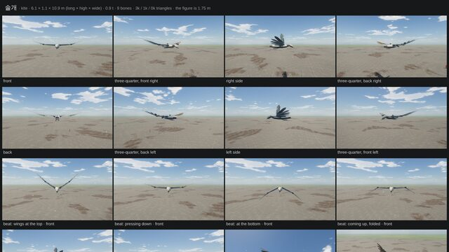</a><br><b>Kite</b> · <sub>9 bones · flies: bank, beat, glide</sub><br>All sides, four moments of a wingbeat, the glide from below, the bank in a turn. Checked on height, bank, load and wing angle.</td><td width="50%" valign="top"><a href="https://github.com/jungrok5/machine-wilds/blob/main/examples/iron-valley/src/26_parts.js">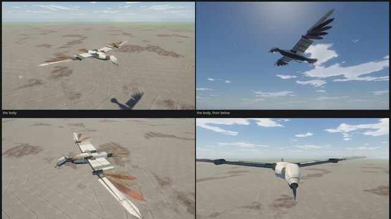</a><br><b>Kite from above and below</b> · <sub>weathered blades, one pale leading edge</sub><br>The feathers are weathered steel; only the back and leading edge are white ceramic. Drives and push rods at the wing roots.</td></tr>
<tr><td width="50%" valign="top"><a href="https://github.com/jungrok5/machine-wilds/blob/main/scripts/gym.mjs">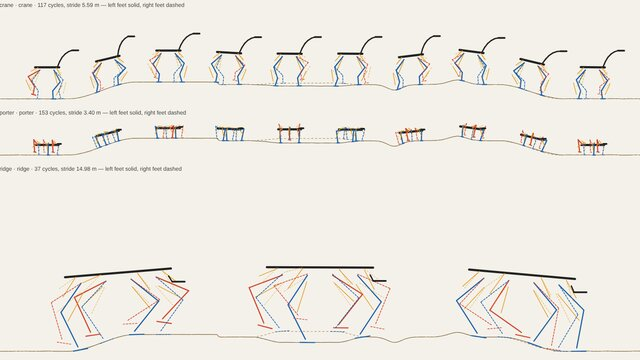</a><br><b>The test course</b> · <sub>gym.mjs --course</sub><br>Ramp, drop, side slope, ditch, mound. Planted feet blue, lifted feet red, cylinders orange; every leg its own length.</td><td width="50%" valign="top"><a href="https://github.com/jungrok5/machine-wilds/blob/main/examples/iron-valley/src/10_land.js">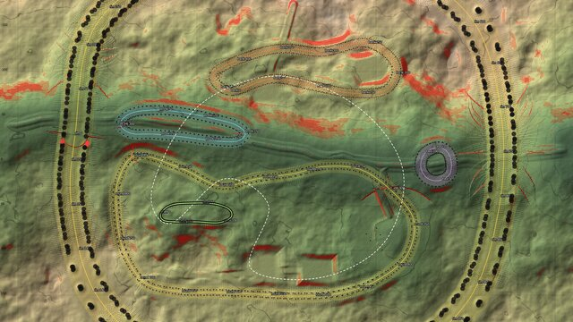</a><br><b>The land and the ways</b> · <sub>gym.mjs --map</sub><br>Slopes steeper than 30° in red; each dot is one footfall.</td></tr>
</table>

## The starter: Lantern Quarry

`starter/` takes a different topic all the way through: a quarry cut in terraces and flooded. It designs its own lamp
warden with two-segment, backward-kneed legs, one walking the rim and one standing in the water, and its own walker's
body.

<table>
<tr><td width="50%" valign="top"><a href="starter/">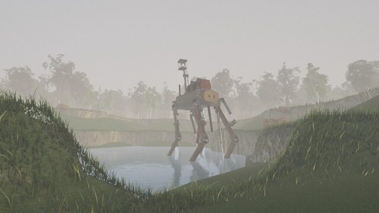</a><br><b>The lamp warden in the water</b> · <sub>warden · 14 t</sub><br>It stands, breathes, and lowers its lamp to the water and back (the set piece dip).</td><td width="50%" valign="top"><a href="starter/">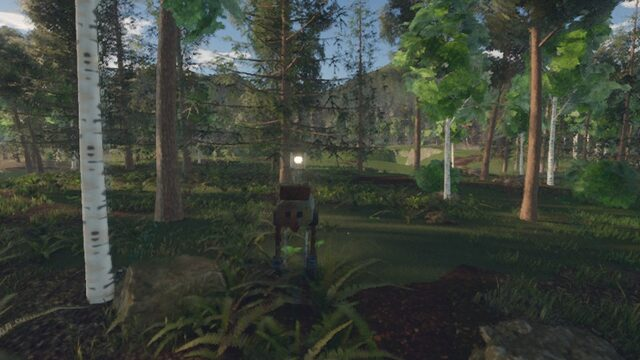</a><br><b>Linkboy with its lamp</b> · <sub>the starter&#x27;s own walker&#x27;s body</sub><br>Two-segment legs with backward knees, designed for the quarry rather than borrowed from the example.</td></tr>
<tr><td width="50%" valign="top"><a href="https://github.com/jungrok5/machine-wilds/blob/main/starter/src/10_realm.js">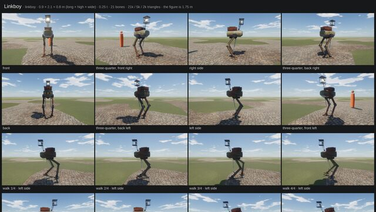</a><br><b>Linkboy</b> · <sub>cast sheet</sub><br>The starter designs its own walker’s body too.</td><td width="50%" valign="top"><a href="https://github.com/jungrok5/machine-wilds/blob/main/starter/src/10_realm.js">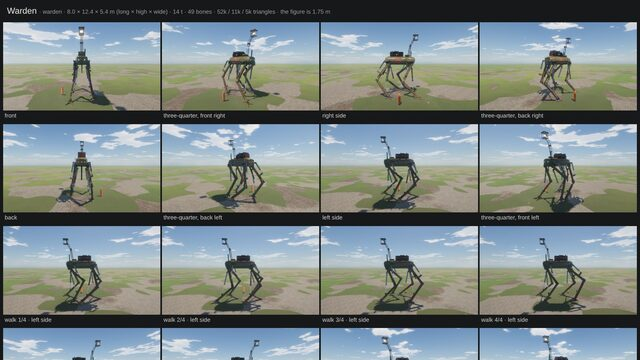</a><br><b>Lamp warden</b> · <sub>cast sheet</sub><br>A fourth kind of body, designed for the quarry.</td></tr>
</table>

## Quick start

Requirements: Node 18+ with Playwright's Chromium, `curl` and ffmpeg. `gym.mjs` needs Node alone. The page needs
WebGL 2 and a real GPU.

```bash
cp -r starter my-realm                              # the starter: a flooded quarry and two wardens
node scripts/gym.mjs my-realm --course --sheet      # the machine on the test course, no browser (out/gym-course.png)
node scripts/gym.mjs my-realm --map --sheet         # on its own way, on the realm's land (out/map.png)
node scripts/fetch-assets.mjs my-realm              # the scans: 28 MB from Poly Haven, CC0
node scripts/build.mjs my-realm                     # writes my-realm/index.html
node scripts/render.mjs my-realm --cast             # each kind turned in a studio (out/cast-<kind>.jpg)
node scripts/check.mjs my-realm                     # must print "check OK"
cd my-realm && python3 -m http.server 8000          # walk it at http://localhost:8000/
```

The example works the same way with `examples/iron-valley` (101 MB of scans). Without the scans a realm still builds
and walks with `?scan=0`, on surfaces baked from code. `SKILL.md` has the whole workflow, from a topic to a finished
realm; `references/` holds the notes behind each step.

Controls: W A S D or the arrows to walk, the mouse to look, Shift to run, Space to hop, V to switch the camera
(first person, behind, above), the wheel or + and − to zoom, B for the lamp. On a phone, two thumbs; a gamepad works
too. You can hop onto the barriers, and jump off the viaduct, land and walk up to a machine. `1` to `4` set the hour,
`5` to `8` the weather, `T` runs the automatic round, `M` toggles sound, `P` shows numbers.

## Limits

The stills and films here were rendered on a machine with no GPU, so frame rates on real GPUs have not been measured;
what is kept in hand is what can be counted (draw calls, triangles, passes; `references/PERF.md`). Machine lamps cast
no shadows of their own, so a beam can leak past a tree. The machines walk fixed ways and do not avoid each other at
run time; the ways are spaced by the offline checks.

## Where it comes from

Made in [motion-skills](https://github.com/jungrok5/motion-skills) from three of its skills:
[`scanned-realm`](https://github.com/jungrok5/motion-skills/tree/main/scanned-realm) for the engine and the scans,
[`walking-colossus`](https://github.com/jungrok5/motion-skills/tree/main/walking-colossus) for the stateless gait, and
[`machine-build-reel`](https://github.com/jungrok5/motion-skills/tree/main/machine-build-reel) for machines as
mechanisms and their checks. It moved here with its history. Scans from <https://polyhaven.com> (CC0).
[AnyMachine](https://github.com/apekshik/anymachine) (MIT) is a reference: `machine-build-reel` follows its method of
building a machine as a parts list and checking it by script, and its shelled machines prompted the example's shelled
kinds. No code, design or asset of it is used, and none of any game's. `references/SOURCE.md` has the details.

## Licence

- Code: [PolyForm Noncommercial 1.0.0](LICENSE.md). Use it, change it and share it for personal and other
  noncommercial purposes. Commercial use (paid courses, client work, products) needs a licence from the owner.
- Films, stills and other pictures: © 2026 jungrok5, all rights reserved ([MEDIA-LICENSE.md](MEDIA-LICENSE.md)).
  Watch and share the original posts; no re-uploads, edits, or use in lectures, courses or ads without permission.
- Parts by others keep their own licences: three.js and meshoptimizer (MIT, in `vendor/`), the Poly Haven scans (CC0,
  not committed). See [CREDITS.md](CREDITS.md).
